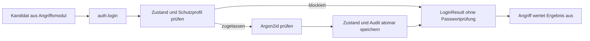

# Ausführliche Projektdokumentation

Dieses Schulprojekt zeigt dieselbe Login-Anwendung ohne Versuchsbegrenzung und mit
einzeln aktivierbaren Schutzmassnahmen. Es läuft vollständig über die Kommandozeile:
Python ab 3.11, SQLite, Argon2id, `argparse` und `logging`. Tests verwenden pytest,
Formatierung und Linting verwenden Ruff. Es gibt keinen Webserver und kein Frontend.

Verwendet ausschliesslich diese eigene, kontrollierte Lernumgebung und die künstlichen
Testkonten. Die kurzen, öffentlich dokumentierten Testpasswörter sind bewusst leicht
auffindbar und dürfen niemals als echte Zugangsdaten verwendet werden. Es gibt weder
Netzwerkangriffe noch Funktionen zum Beschaffen fremder Zugangsdaten. Ausser der
Paketinstallation benötigt die Anwendung keinen Internetzugriff.

## Installation unter Windows

Im Projektverzeichnis mit einer vorhandenen Python-Version ab 3.11:

```powershell
py -3 --version
py -3 -m venv .venv
.\.venv\Scripts\python.exe -m pip install -r requirements-dev.txt
```

Falls der Python-Launcher `py` fehlt, stattdessen `python --version` und
`python -m venv .venv` verwenden. Die Umgebung muss nicht aktiviert werden;
das vermeidet Probleme mit der PowerShell-Ausführungsrichtlinie.
Installation und Befehle immer aus diesem Projektverzeichnis ausführen.

`pyproject.toml` legt direkte Abhängigkeiten exakt fest: `argon2-cffi==25.1.0`,
`pytest==8.4.2` und `ruff==0.14.2`. `requirements-dev.txt` ergänzt die beim Prüflauf
verwendeten transitiven Versionen. Das sind bewusst festgelegte, geprüfte Versionen,
keine Behauptung über die jeweils neueste Veröffentlichung. Die Build-Abhängigkeit
ist separat in `pyproject.toml` angegeben. Ohne Entwicklungswerkzeuge reicht:

```powershell
.\.venv\Scripts\python.exe -m pip install -e .
```

Auf Linux/macOS entspricht `.venv/bin/python` dem Windows-Pfad. Das Projekt verwendet
`pathlib` und keine betriebssystemspezifischen Dateipfade im Anwendungscode.

## Architektur und Dateistruktur

```text
bruteforce_demo/
  __main__.py                Startpunkt mit __main__-Guard
  cli.py                     argparse, Verwaltung, verständliche Ausgaben
  models.py                  LoginResult und Variant
  database.py                Schema, Testdaten, Verbindungen, expliziter Reset
  auth.py                    einzige Login-Schnittstelle und Transaktionsablauf
  attacks/
    common.py                Limits, serieller Ablauf, Ergebnisstatistik
    terminal.py              optionale Live-Anzeige mit --live
    mono.py                  numerische Kandidaten
    dictionary.py            Wortliste und feste Varianten
    poly.py                  gemischter Zeichensatz, lazy Kandidaten
    parallel.py              disjunkte Bereiche und spawn-Worker
  defenses/
    policy.py                gespeicherte Konfiguration und Profile
    fixed.py                 konstante Wartezeit
    progressive.py           steigende, begrenzte Wartezeit
    lockout.py               Sperrschwelle
    audit.py                 logging-Handler für SQLite und lokale Alarmmeldung
  data/words.txt             ausschliesslich erfundene Lernwörter
tests/                       temporäre Datenbanken, kontrollierte Zeit, echte Worker
docs/
  BEWERTUNG.md               Zuordnung zu Kategorien und Teamarbeit
  MESSUNGEN.md               leere Vorlage und fairer Parallelvergleich
  PRUEFUNG.md                tatsächlich ausgeführte Prüfungen
pyproject.toml
requirements-dev.txt
.gitignore
```



Die gemeinsame Schnittstelle lautet:

```python
login(path, username, password, variant="protected") -> LoginResult
```

`LoginResult` enthält `status` (`success`, `invalid`, `waiting`, `locked`),
`password_checked`, `retry_after` in Sekunden und die abgeleitete Eigenschaft `blocked`.
Ein unbekanntes Konto ergibt `invalid` und `password_checked=False`: Es existiert kein
Hash zur Prüfung. Die Antwort unterscheidet im Status nicht zwischen unbekanntem
Konto und falschem Passwort. Zeitunterschiede werden hier nicht kaschiert.

Die Angriffe erzeugen Kandidaten und verwenden diese Schnittstelle. Sie importieren
keine Datenbankfunktionen und lesen keine Hashes oder Sperrzustände. Nur die Verwaltung
(`init`, `configure`, `reset`, `events`, `status`) greift zusätzlich auf die Datenhaltung zu.
Der injizierbare Zeitgeber ist ausschliesslich für Tests vorgesehen; die Angriffs-CLI
bietet keine manipulierte Zeit an.

## Testkonten und Passwortspeicherung

**Ausschliesslich künstliche DEMO-Testpasswörter:**

| Konto | Testpasswort | Zweck |
|---|---|---|
| `pin` | `0007` | Mono und Parallel, führende Nullen |
| `dictionary` | `Lernwort1` | deterministische Wortvariante |
| `poly` | `a1` | kurzer gemischter Zeichensatz |

Gespeichert werden nur individuell gesalzene Argon2id-Hashes. Das explizite Profil
`RFC_9106_LOW_MEMORY` verwendet 65'536 KiB (64 MiB), drei Durchläufe und vier
Argon2-Threads, 16 Byte Zufallssalz sowie 32 Byte Hashausgabe. Der kodierte Hash
enthält Algorithmus, Parameter und Salz. Ein Salz ist kein Geheimnis und muss nicht
separat versteckt werden. Auch gleiche Passwörter bekommen verschiedene Hashes.
Die Parameter werden für die Demo und für die Tests nicht abgeschwächt.
Quellen: [argon2-cffi-API](https://argon2-cffi.readthedocs.io/en/stable/api.html),
[RFC 9106, Empfehlungen](https://www.rfc-editor.org/rfc/rfc9106.html#section-7.4).

`insecure` bedeutet ausschliesslich: keine Wartezeit, keine Versuchsbegrenzung,
keine Kontosperre. Auch hier gelten Argon2id und parametrisierte SQL-Abfragen.
Logging und ein lokaler Alarm sind auch bei `insecure` aktiv, verhindern aber keinen
Versuch. `protected` ist die Voreinstellung aller Login- und Angriffsbefehle.
Beide Varianten teilen die Testkonten, führen jedoch getrennte Fehlversuchszustände.
Ein unsicherer Login hebt deshalb keine geschützte Kontosperre auf.

## Vorführung mit genauen Befehlen

### 1. Datenbank initialisieren

```powershell
.\.venv\Scripts\python.exe -m bruteforce_demo init
```

Erstellt `runtime/demo.db` mit Testkonten und Standardprofil. Eine bereits vorhandene
Datei führt zu einer Fehlermeldung und bleibt erhalten. Auch Login-Aufrufe erzeugen
keine fehlende Datenbank automatisch. Für eine zusätzliche, unabhängige Demo:

```powershell
.\.venv\Scripts\python.exe -m bruteforce_demo --db runtime/zweite-demo.db init
```

`--db` steht **vor** dem Unterbefehl. Eine bestehende Datenbank wird weder von `init`
noch von einem Angriff gelöscht. Für eine Wiederholung den ausdrücklichen `reset`
verwenden; für eine frische Datenbank einen neuen Dateinamen wählen.

### 2. Vier Angriffe auf die unsichere Variante

```powershell
.\.venv\Scripts\python.exe -m bruteforce_demo attack mono --variant insecure --username pin --min-length 4 --max-length 4 --max-calls 30 --max-seconds 10
.\.venv\Scripts\python.exe -m bruteforce_demo attack dictionary --variant insecure --username dictionary --max-calls 30 --max-seconds 10
.\.venv\Scripts\python.exe -m bruteforce_demo attack poly --variant insecure --username poly --letters ab --digits 01 --min-length 2 --max-length 2 --max-calls 20 --max-seconds 10
.\.venv\Scripts\python.exe -m bruteforce_demo attack parallel --variant insecure --username pin --length 4 --start 0 --stop 16 --workers 2 --max-calls 30 --max-seconds 10
```

Mono erzeugt `0000`, `0001`, …; das Testpasswort steht an achter Stelle.
Dictionary erzeugt pro Wort Original-, Klein-, Gross- und Anfangsgrossschreibung,
jeweils ohne Suffix, mit `1`, mit `2`. Doppelte Kandidaten werden über ein `set`
unterdrückt, ausgegeben wird weiterhin in fester Reihenfolge. `Lernwort1` steht an
achter Stelle. Poly verwendet standardmässig `ab01` und liefert `aa`, `ab`, `a0`, `a1`, …;
hier steht das Testpasswort an vierter Stelle. Optionale Sonderzeichen lassen sich
zum Beispiel mit `--symbols '!?'` ergänzen.
Eine eigene **künstliche** Wortliste ist mit `--wordlist pfad/zur/liste.txt` möglich.

Die Parallel-Demo durchsucht `[0, 16)`, also `0000` bis `0015`. `--stop` ist exklusiv.
Die Länge ist dabei fest. `divmod` verteilt Restkandidaten auf die ersten Worker;
es entstehen disjunkte, lückenlose Intervalle mit höchstens einem Kandidaten
Grössenunterschied. Jeder Worker bearbeitet seinen eigenen Bereich.

### 3. Dieselben Angriffe auf das Standardprofil

```powershell
.\.venv\Scripts\python.exe -m bruteforce_demo configure --profile standard
.\.venv\Scripts\python.exe -m bruteforce_demo attack mono --variant protected --username pin --min-length 4 --max-length 4 --max-calls 30 --max-seconds 10
.\.venv\Scripts\python.exe -m bruteforce_demo reset
.\.venv\Scripts\python.exe -m bruteforce_demo attack dictionary --variant protected --username dictionary --max-calls 30 --max-seconds 10
.\.venv\Scripts\python.exe -m bruteforce_demo reset
.\.venv\Scripts\python.exe -m bruteforce_demo attack poly --variant protected --username poly --letters ab --digits 01 --min-length 2 --max-length 2 --max-calls 20 --max-seconds 10
.\.venv\Scripts\python.exe -m bruteforce_demo reset
.\.venv\Scripts\python.exe -m bruteforce_demo attack parallel --variant protected --username pin --length 4 --start 0 --stop 16 --workers 2 --max-calls 30 --max-seconds 10
```

Diese Clients warten absichtlich nicht freiwillig. Nach dem ersten falschen Passwort
werden die folgenden schnellen Aufrufe normalerweise durch die gespeicherte Wartezeit
abgelehnt. Konkrete Zahlen hängen vom Zeitablauf ab; für einen zeitlich unabhängigen
Schwellenvergleich folgt die Sperrdemo. Ein blockierter Kandidat wird vom einfachen
Demo-Client verworfen. „Suchraum ausgeschöpft“ bedeutet daher, dass alle Kandidaten
an die Schnittstelle übergeben wurden, nicht dass alle Hashprüfungen stattgefunden haben.
Die Auswertung muss immer die Zahl tatsächlich geprüfter Passwörter berücksichtigen.

### 4. Sperre, Protokoll und Alarm vorführen

```powershell
.\.venv\Scripts\python.exe -m bruteforce_demo configure --profile logging --lock-threshold 5 --lock-seconds 10 --alarm-threshold 3
.\.venv\Scripts\python.exe -m bruteforce_demo attack mono --variant protected --max-calls 30 --max-seconds 10
.\.venv\Scripts\python.exe -m bruteforce_demo events --limit 30
.\.venv\Scripts\python.exe -m bruteforce_demo status
.\.venv\Scripts\python.exe -m bruteforce_demo login pin --variant protected
```

Hier sind Wartezeiten deaktiviert, Sperre und Logging dagegen gemeinsam aktiv:
fünf falsche Passwortprüfungen lösen die Sperre aus. Der dritte Fehlversuch löst
bereits einen lokalen Alarm auf stderr und ein `ALARM`-Audit-Ereignis aus.
Bei 30 schnellen Aufrufen sind danach 25 blockiert, sofern die zehnsekündige Sperre
noch aktiv ist. Die fünfte falsche Prüfung zählt als geprüft; erst der nächste Aufruf
erhält `locked`. Das manuelle Login fragt das Passwort verdeckt ab und nennt bei
einer Sperre die verbleibende Zeit. Nach Ablauf der Sperre ist `0007` wieder möglich.
Für ein sauberes Wiederholen vor Ablauf: den expliziten Reset unten verwenden.

### 5. Massnahmen einzeln vergleichen

```powershell
.\.venv\Scripts\python.exe -m bruteforce_demo configure --profile fixed --fixed-seconds 1
.\.venv\Scripts\python.exe -m bruteforce_demo attack mono --max-calls 20
.\.venv\Scripts\python.exe -m bruteforce_demo configure --profile progressive --base-seconds 0.25 --cap-seconds 2
.\.venv\Scripts\python.exe -m bruteforce_demo attack mono --max-calls 20
.\.venv\Scripts\python.exe -m bruteforce_demo configure --profile lockout --lock-threshold 5 --lock-seconds 10
.\.venv\Scripts\python.exe -m bruteforce_demo attack mono --max-calls 20
.\.venv\Scripts\python.exe -m bruteforce_demo configure --profile logging
.\.venv\Scripts\python.exe -m bruteforce_demo attack mono --max-calls 20
```

`configure` ist eine ausdrückliche Verwaltungsaktion: Es speichert das Profil und
setzt alle **geschützten** Zustände zurück. Audit-Ereignisse bleiben erhalten.
Die Einstellung gilt für spätere Programmstarts und sämtliche Worker.
Kein Angriffsskript setzt Zustände zurück oder konfiguriert selbst Schutzmassnahmen.

| Profil | Wartezeit | Sperre | Logging und Alarm |
|---|---|---|---|
| `standard` | progressiv: Basis 0,25 s, Maximum 2 s | 5 Fehler, 10 s | ja, ab 3 Fehlern |
| `fixed` | konstant: 1 s | aus | aus |
| `progressive` | Basis 0,25 s, Maximum 2 s | aus | aus |
| `lockout` | aus | 5 Fehler, 10 s | aus |
| `logging` | aus | aus | ja, ab 3 Fehlern |
| `none` | aus | aus | aus |

Die Parameter können mit den gezeigten Optionen geändert werden. Beispielsweise
kombiniert `--profile fixed --lock-threshold 5` feste Wartezeit und Sperre.
Das Profil `none` ist ein ausdrücklicher Vergleich ohne Schutz. Das Standardprofil
wiederherstellen mit `configure --profile standard`.

Für einen nachvollziehbaren Verlauf der progressiven Wartezeit nach einer falschen
manuellen Anmeldung jeweils die genannte Wartezeit verstreichen lassen und erneut
falsch anmelden. Alternativ demonstrieren die Tests die ganze Folge ohne echte Pausen.

### 6. Expliziter Reset und Qualitätsprüfung

```powershell
.\.venv\Scripts\python.exe -m bruteforce_demo reset
.\.venv\Scripts\python.exe -m bruteforce_demo reset --clear-events
.\.venv\Scripts\python.exe -m bruteforce_demo configure --profile standard
.\.venv\Scripts\python.exe -m pytest -q
.\.venv\Scripts\python.exe -m ruff check .
.\.venv\Scripts\python.exe -m ruff format --check .
```

`reset` entfernt Fehlversuchszustände beider Varianten, behält aber Konten, Hashes,
Audit-Ereignisse und Profil. Nur `--clear-events` löscht zusätzlich die Ereignisse.
Vor einem Reset alle laufenden Angriffe beenden: Eine Verwaltungsaktion während
eines Angriffs verändert bewusst dessen Versuchsbedingungen.
Generierte Datenbanken, Umgebungen und Logs werden durch `.gitignore` ausgeschlossen.

## Schutzlogik, Transaktionen und Protokolle

Die SQLite-Tabellen sind `users`, `login_state`, `policy`, `audit_events` sowie
`demo_meta` zur Kennzeichnung der Demo-Schemaversion. Verbindungen werden pro Aufruf
geöffnet und in jedem Fall geschlossen. Es wird keine Verbindung an Worker vererbt.
SQL-Werte werden mit Platzhaltern gebunden.

Jeder Login beginnt mit `BEGIN IMMEDIATE`. Innerhalb derselben Transaktion folgen:

1. Gespeichertes Profil und aktuellen Kontozustand lesen.
2. Sperrzeit bzw. `next_allowed_at` prüfen; gegebenenfalls ohne Argon2 abbrechen.
3. Genau eine Passwortprüfung für ein bekanntes, zugelassenes Konto ausführen.
4. Fehlerzähler, Zeitpunkte, Alarmzustand und Audit-Ereignisse ändern und committen.

SQLite erlaubt nur eine gleichzeitige Schreibtransaktion. Deshalb sieht der nächste
Prozess immer den vom Vorgänger bestätigten Fehlerzähler. Es gibt keinen Ablauf
„beide lesen 4, beide schreiben 5“. Absichtlich bleibt die teure Hashprüfung innerhalb
der Transaktion: leicht erklärbar und korrekt, aber sämtliche Logins dieser Datei
werden dabei serialisiert, auch bei verschiedenen Konten. Der Verbindungs-Timeout
beträgt zehn Sekunden; bei anhaltender Konkurrenz wird ein Datenbankfehler gemeldet.
Transaktionsfehler werden zurückgerollt und nicht als reguläres Login-Ergebnis versteckt.
Quelle: [SQLite-Transaktionen](https://www.sqlite.org/lang_transaction.html).

Nach einer fehlgeschlagenen Prüfung beginnt die Wartezeit am Ende der Hashprüfung:

- Feste Wartezeit: `next_allowed_at = jetzt + fixed_seconds`.
- Progressiv: `delay = min(cap_seconds, base_seconds * 2**(failures - 1))`.
  Bei Basis 0,25 s und Grenze 2 s ergibt das 0,25; 0,5; 1; 2; 2; … Sekunden.
  Der Code erkennt die Obergrenze vor einer möglicherweise riesigen Potenz.
- Sperre: Ab der konfigurierten Anzahl **falscher Prüfungen** wird
  `locked_until = jetzt + lock_seconds` gesetzt. Eine noch aktive Sperre hat Vorrang.

Blockierte Aufrufe verändern weder Fehlerzähler noch Sperrende und erzeugen keine
neuen Fehler-, Sperr- oder Alarmereignisse. Nach Ablauf einer Kontosperre beginnt beim
nächsten Versuch eine neue Fehlerserie; alte Wartezeit und Alarmmarkierung werden
verworfen. Ein erfolgreicher Login setzt Fehlerzähler, beide Zeitpunkte und
Alarmmarkierung der betreffenden Variante zurück. Ein korrektes Passwort während
einer aktiven Sperre wird ebenfalls abgewiesen.

Persistente Zeitpunkte verwenden Unix-Zeit (`time.time`), damit neue Prozesse sie
interpretieren können. Eine verstellte Systemuhr kann diese Demo beeinflussen.
Laufzeiten verwenden die monotone Uhr (`time.monotonic`). Schutzmassnahmen verwenden
keine langen `sleep`-Aufrufe. Ein Client muss sie nicht freiwillig einhalten.

Der `logging.Handler` schreibt strukturierte Ereignisse in `audit_events`, kein
gemeinsam geöffnetes Textlog. Ereignisse enthalten Zeitstempel, Ereignistyp, Konto
und Variante. UTC-Zeit wird bei `events` lesbar ausgegeben. Es werden weder Kandidaten
noch richtige Passwörter, Hashes oder Geheimnisse protokolliert. Die Alarmhäufung ist
hier genau definiert: drei aufeinanderfolgende falsche Passwortprüfungen für ein Konto
seit Erfolg, Sperrablauf oder ausdrücklichem Reset; kein gleitendes Zeitfenster.
Unbekannte Benutzernamen werden bei aktivem Audit als Fehler protokolliert, erhalten
aber keinen Kontozähler oder Kontoalarm. Pro Fehlerserie gibt es höchstens einen Alarm.
`ALARM` hat Logging-Level WARNING, die anderen Ereignisse INFO. Die lokale Meldung
erfolgt nach erfolgreichem Commit. Logging dient Erkennung und Nachvollziehbarkeit;
allein verhindert es keinen Angriff.

## Aufrufe, Grenzen und parallele Ausführung

Die Zusammenfassung nennt Angriffsart, Zielvariante, abgeschlossene Login-Aufrufe,
tatsächliche Passwortprüfungen, blockierte Aufrufe, Laufzeit und Ergebnis.
Ein blockierter Aufruf ist keine weitere Passwortprüfung. Ein unbekanntes Konto
ist ebenfalls keine Hashprüfung, aber auch keine Sperre. Ohne `--live` erscheint ein
gefundenes Testpasswort ausschliesslich in der `DEMO-ERGEBNIS`-Zeile. Mit `--live`
zeigt eine als `DEMO-LIVE` gekennzeichnete Tabelle zusätzlich jeden abgeschlossenen
Versuch: künstlicher Testkandidat, Status, Aufrufe, Prüfungen und blockierte Aufrufe.
Die Anzeige wartet nicht künstlich; sie erzeugt keine Audit-Einträge.

Alle Angriffe haben ein globales Aufruflimit (Standard 30) und ein Zeitlimit
(Standard 10 s); beide sind positiv und konfigurierbar. Bei Parallel zählt eine
gemeinsame, mit Lock geschützte Reservierung die Aufrufe über alle Worker hinweg.
Die Zeitmessung enthält den Workerstart. Eine bereits begonnene Anmeldung wird bei
Zeitablauf oder Erfolg eines anderen Workers fertig bearbeitet. Daher kann das
Zeitlimit um laufende Hashprüfung und Datenbankwartezeit überschritten werden;
es ist keine garantierte harte Echtzeitgrenze.

`spawn` startet frische Python-Prozesse und funktioniert unter Windows. Der
`__main__`-Guard in `__main__.py` verhindert rekursive Prozessstarts beim Modulimport.
Auch eigener Code, der `run_parallel` direkt startet, benötigt diesen Guard.
Worker senden kleine Zusammenfassungen über Pipes, bei `--live` zusätzlich die
einzelnen Versuchsergebnisse. Nur der Elternprozess gibt Tabelle und Demo-Ergebnis
aus. Ein gemeinsames Event beendet die übrigen Worker nach einem Fund.
Bis zu `workers - 1` bereits begonnene Aufrufe können noch fertig werden. Die genaue
Bearbeitungsreihenfolge ist parallel nicht deterministisch; die Aufteilung ist es.

Ctrl+C beendet serielle Angriffe mit Zusammenfassung. Während eines gerade
unterbrochenen seriellen Login-Aufrufs kann dieser unvollständige Aufruf nicht als
abgeschlossen gezählt werden; SQLite rollt die offene Transaktion zurück. Im
Parallelbetrieb setzt der Elternprozess bei SIGINT das Stop-Event; Worker ignorieren
SIGINT und schliessen ihren aktuellen Login sauber ab. Anschliessend sammelt der
Elternprozess Ergebnisse und wartet auf das Ende. Nur bei aussergewöhnlichem Hängen
gibt es eine begrenzte Aufräumphase mit anschliessender Prozessbeendigung und Fehler.

Quelle zum sicheren Modulstart:
[Python multiprocessing](https://docs.python.org/3/library/multiprocessing.html#the-spawn-and-forkserver-start-methods).

Mehr Prozesse garantieren keinen Geschwindigkeitsgewinn. SQLite serialisiert hier
die Prüfungen, Argon2 benutzt bereits eigene Threads und Prozessstarts kosten Zeit.
Bei frühem Fund vergleichen die Läufe ausserdem eventuell verschieden viele
Passwortprüfungen. Einen faireren Vergleich mit gleichem Arbeitsumfang und eine
leere Ergebnistabelle enthält [docs/MESSUNGEN.md](MESSUNGEN.md).

## Suchraum, Online- und Offline-Angriffe

Bei `k` verschiedenen Zeichen und fester Länge `n` gibt es `k**n` Kandidaten.
Für mehrere Längen ergibt sich `sum(k**n for n in range(min_length, max_length + 1))`.
Jede weitere Stelle multipliziert den Suchraum mit `k`: vier Ziffern ergeben 10'000
Kandidaten, zehn Ziffern bereits 10'000'000'000. Schon 62 Zeichen bei Länge zehn ergeben
839'299'365'868'340'224 Kombinationen. **Bis zehn Zeichen unterstützen bedeutet nicht,
dass solche Suchräume praktisch vollständig durchsucht werden können.**

Mono und Poly erzeugen Kandidaten mit `itertools.product` lazy: Im Speicher liegt
kein vollständiger Suchraum. Das verkürzt nicht die nötige Rechenzeit. Dictionary
speichert die kleine Wortliste und die bereits ausgegebenen Varianten zur Deduplizierung.
Die kurzen Testpasswörter stehen früh in der Reihenfolge, damit echtes Argon2id
verwendet werden kann und die Vorführung trotzdem kurz bleibt.

Ein **Online-Angriff** übergibt jeden Kandidaten einer Authentifizierungslogik und
unterliegt deren Beschränkungen. Diese lokale Schnittstelle simuliert genau das,
auch wenn kein Netzwerk beteiligt ist. Ein **Offline-Angriff** prüft gestohlene Hashes
selbst; Kontosperren und Login-Wartezeiten greifen dort nicht. Salz und ein teures
Passwort-Hashverfahren sind dafür weiterhin wichtig.

Eine einfache Liste aus Passwort und Hash ist eine Nachschlagetabelle, keine echte
Rainbow-Table. Rainbow-Tables komprimieren vorberechnete Suchräume durch Ketten aus
Hash- und Reduktionsschritten mit wechselnden Reduktionsfunktionen. Individuelle Salze
verhindern die einfache Wiederverwendung einer vorberechneten Tabelle für viele
Konten; Argon2 macht jeden Rechenschritt zusätzlich teuer. Rainbow-Tables sind kein
implementierter Teil dieses Projekts und betreffen ein anderes Offline-Szenario.
Quelle zur Konstruktion echter Rainbow-Tables:
[Philippe Oechslin: Making a Faster Cryptanalytic Time-Memory Trade-Off](https://www.iacr.org/archive/crypto2003/27290615/27290615.pdf).

## Grenzen und CIA-Triade

Die Trennung zwischen Angriffsmodulen und Login ist eine **didaktische Schnittstelle,
keine echte Sicherheitsgrenze gegen jemanden mit lokalem Dateizugriff**. Wer die
Projektdateien und Datenbank ändern darf, kann Hashes lesen, Programme verändern,
die Systemzeit verstellen, Profile ändern oder die ausdrücklich angebotene unsichere
Variante starten. Es gibt keine administrative Zugriffskontrolle für Demo-Befehle,
keine manipulationssicheren Audit-Logs und keine Benutzerisolierung durch das Betriebssystem.
Auch eine CLI-Beschränkung auf die drei Testkonten ändert daran nichts.

Die Anwendung ist keine Produktionsauthentifizierung: Keine Absicherung gegen
Benutzernamenerkennung über Laufzeiten, kein globales Limit für unbekannte Konten,
keine verteilte Infrastruktur, keine Passwortänderung und keine Sitzungsverwaltung.
Argon2-Parameter sind explizit festgelegt; eine spätere Migration mit Rehashing wäre
eine eigenständige Erweiterung. Bei jedem Login neu zu hashen wäre dagegen falsch:
Geprüft wird mit dem gespeicherten kodierten Hash.

| Schutzziel | Beitrag und Grenze |
|---|---|
| Vertraulichkeit | Argon2id und Salz schützen gespeicherte Passwörter gegen einfache Rückgewinnung; Wartezeit und Sperre begrenzen Online-Raten. Kurze Demo-Passwörter bleiben schwach. Die SQLite-Datei ist nicht verschlüsselt. |
| Integrität | Parametrisierte Abfragen verhindern SQL-Injection durch Eingabewerte; Transaktionen erhalten konsistente Zähler und Ereignisse. Lokale Dateimanipulation wird nicht verhindert. |
| Verfügbarkeit | Limits reduzieren teure Hashprüfungen bei wiederholten Fehlversuchen. Kontosperren können aber gezielt gegen legitime Benutzer ausgelöst werden. Die serialisierten Datenbankzugriffe sind ebenfalls ein Engpass. |

Eine private Notiz ist bewusst nicht implementiert. Das Login-Ergebnis wird deshalb
nicht als Berechtigung für Datenzugriffe ausgegeben. Ein frei gesetzter Benutzername
oder ein Boolean wäre dafür unzureichend; eine Erweiterung bräuchte beispielsweise
zufällige, serverseitig gespeicherte und zeitlich begrenzte Sitzungstoken mit
Berechtigungsprüfung bei **jedem** Lese- und Schreibzugriff. Hier werden keine solchen
zusätzlichen Schutzfunktionen behauptet.

## Tests und nachvollziehbare Zusammenarbeit

Tests verwenden temporäre Datenbankkopien mit echten Argon2id-Hashes. Ein kontrollierter
Zeitgeber ersetzt echte Wartezeiten. Geprüft werden korrekte/falsche Anmeldung,
unbekannte Benutzer, SQL-Parameterbindung, unbegrenzte unsichere Versuche, Kandidaten,
individuelle Salze, Schutzprofile, Sperrablauf, Reset, Alarmierung ohne Passwortlecks,
Limits und parallele Konsistenz. Echte `spawn`-Worker prüfen gemeinsame Kontosperren,
Erfolgsabbruch und globale Limits. Der SIGINT-Test löst das Signal gezielt im Elternprozess
aus. Ausführungsnachweise und verbleibende Grenzen stehen in [docs/PRUEFUNG.md](PRUEFUNG.md).

Vorschlag für echte Arbeitsteilung, keine Behauptung bereits geleisteter Teamarbeit:

- **Person A:** `attacks/` und zugehörige Tests; Kandidaten, Aufteilung und Messungen erklären.
- **Person B:** `auth.py`, `database.py`, `defenses/` und zugehörige Tests; Zustände und Transaktionen erklären.
- **Gemeinsam:** Schnittstelle zuerst vereinbaren, gegenseitig Code prüfen, README und Demo
  pflegen, Rollen bei einer Probevorführung tauschen und Wissen weitergeben.

Kurze fachliche Commits und echte Reviews machen Beiträge nachvollziehbar. Im Review
erklärt jeweils die andere Person mindestens einen Test und den zugehörigen Code.
[docs/BEWERTUNG.md](BEWERTUNG.md) ordnet Funktionen Bewertungskategorien zu.
Eine bestimmte Note ist nicht garantiert; die genaue Auslegung des Bewertungsrasters
muss mit der Lehrperson geklärt werden.

## Zehn Fragen für das Fachgespräch

1. **Warum ist die unsichere Variante trotz Argon2 angreifbar?**
   Sie erlaubt beliebig viele Passwortprüfungen. Argon2 verteuert sie, begrenzt sie aber nicht.
2. **Was bewirkt das individuelle Salz?**
   Gleiche Passwörter ergeben unterschiedliche Hashes; vorberechnete Tabellen lassen sich
   nicht einfach über viele Konten wiederverwenden. Das Salz ist kein geheimer Schlüssel.
3. **Warum genügt ein `sleep` im Angriff nicht als Schutz?**
   Der Angreifer kann es entfernen. Hier entscheidet die Login-Logik anhand gespeicherter
   Zeitpunkte, ob sie überhaupt einen Hash prüfen darf.
4. **Warum sind 30 Aufrufe nicht immer 30 Passwortprüfungen?**
   Sperren und Wartezeiten weisen Aufrufe vor Argon2 ab. Auch ein unbekanntes Konto hat keinen Hash.
5. **Wie funktioniert die progressive Wartezeit?**
   Basis mal zwei hoch Fehlerzahl minus eins, gedeckelt durch die Obergrenze; nur eine
   tatsächliche falsche Passwortprüfung erhöht die Fehlerzahl.
6. **Wie vermeidet ihr verlorene Zähler bei parallelen Zugriffen?**
   `BEGIN IMMEDIATE` serialisiert Lesen, Prüfen und Schreiben. Kein anderer Login kann
   zwischen diesen Schritten denselben alten Zustand verwenden.
7. **Warum kann Parallelisierung langsamer sein?**
   Prozessstarts kosten Zeit, Argon2 verwendet eigene Threads und die SQLite-Transaktion
   serialisiert die Logins. Deshalb messen wir mit gleichem Arbeitsumfang.
8. **Warum wächst der Suchraum so schnell?**
   Bei `k` Zeichen und Länge `n` gibt es `k**n` Kombinationen; jede Stelle multipliziert mit `k`.
9. **Welche CIA-Ziele helfen bzw. schaden die Schutzmassnahmen?**
   Raten wird erschwert und Zähler bleiben konsistent. Eine absichtlich ausgelöste
   Kontosperre kann gleichzeitig die Verfügbarkeit eines legitimen Kontos beeinträchtigen.
10. **Warum ist das keine echte Sicherheitsgrenze und keine Rainbow-Table-Demo?**
    Lokaler Dateizugriff ermöglicht Manipulation und Offline-Prüfungen. Unsere Angriffe
    verwenden dagegen den Login. Rainbow-Tables bestehen aus vorberechneten Hash-/Reduktionsketten.

